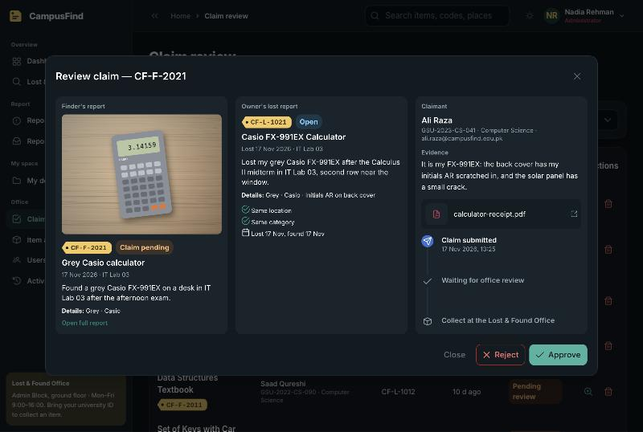
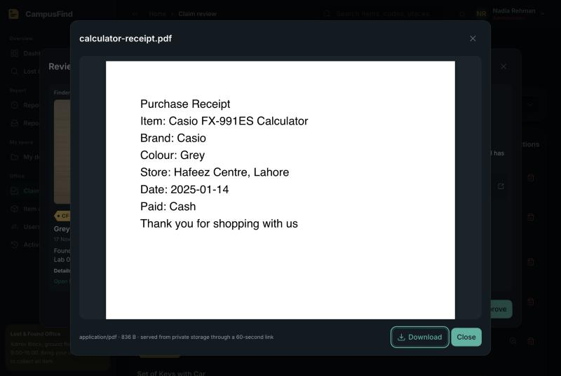

# CampusFind API — University Lost & Found

Express + TypeScript + MongoDB backend for **CampusFind**: students report lost and found belongings, claim items with evidence, and the lost & found office approves claims and confirms handovers. Files live in a **private bucket on our own VPS** and are only reachable through 60-second signed links.

Frontend repo: https://github.com/MalikHamza007/campusfind-frontend · Live app: https://vspark.learn2earntech.com · API: https://api.vspark.learn2earntech.com/api



## Features (rubric map)
| Area | What's implemented | Where |
|---|---|---|
| Auth (15) | Register (students only, no `role` accepted), login, logout, session restore via rotating refresh cookie with reuse detection, bcrypt, rate-limited auth routes, deactivation kicks sessions | `src/controllers/auth.controller.ts`, `src/services/token.service.ts`, `src/middlewares/auth.ts` |
| Database & CRUD (20) | Items, claims, files, users, audit logs in MongoDB; list/search/filter/paginate; create/update with optimistic `version`; soft delete with dependency protection; transactions for claim transitions | `src/controllers/*`, `src/services/claim.service.ts` |
| Storage (10) | Private bucket (`StorageProvider` → local VPS dir or S3), magic-byte sniffing, per-purpose limits, atomic `.part` writes, orphan cleanup, tombstone delete, 60 s HMAC links, in-app preview | `src/services/storage/*`, `src/services/file.service.ts`, `docs/LIVE_STORAGE_CHECK.md` |
| External API (15) | OpenStreetMap **Nominatim** search + reverse geocoding through our proxy: 1 req/s throttle, timeout, Mongo TTL cache, stale-cache fallback, landmark fallback on 429/outage | `src/services/geo.service.ts` |
| Dashboard | Role-scoped KPIs with 8-week sparklines, charts (category, status, location, timeline, funnel), queues, activity, system health | `src/controllers/dashboard.controller.ts` |
| Security | Helmet, strict CORS allowlist (JSON 403 for unknown origins), rate limits, Zod validation everywhere, IDOR-safe 404s, audit log (append-only) | `src/app.ts`, `src/middlewares/*` |

## Architecture
```
Angular (vspark.learn2earntech.com) ──HTTPS + Bearer + cf_rt cookie──▶ Nginx (api.vspark…) ─▶ Express (PM2, 127.0.0.1:<PORT>)
                                                                                         ├─ MongoDB Atlas (replica set: transactions)
                                                                                         ├─ Private bucket /var/lib/campusfind/storage  (never served by Nginx)
                                                                                         └─ Nominatim proxy (cache in Mongo, 1 req/s)
src/
  app.ts, server.ts         config/ (env validation, db, campus)
  routes/index.ts           controllers/   services/ (storage, file, geo, claim, item, token, audit)
  middlewares/ (auth, cors, rate limit, validate, error)   validators/ (Zod)   models/   utils/
  scripts/seed.ts, seed-admin.ts, seed-data.ts             seed-assets/ (photos, receipts, avatars)
tests/   (Vitest + supertest + mongodb-memory-server replica set)
```

## Private bucket storage
- **Key layout:** `files/<yyyy>/<mm>/<uuid>` inside `STORAGE_ROOT` (prod: `/var/lib/campusfind/storage`, mode `0700`, outside every web root). No user-supplied names touch the disk; the sanitized original name lives only in Mongo with mime, size, sha256, purpose and uploader.
- **Upload pipeline:** auth + per-user rate limit (10/min) run **before** the multipart body is parsed → bytes held in memory (≤8 MB) → magic-byte sniff + extension match + per-purpose size/type rules (SVG/HTML/scripts/double extensions rejected) → write `<key>.part` with `wx` (write-once) → atomic rename → insert metadata; if the insert fails the object is deleted; stale `.part` files are swept on startup.
- **Access policy:** item photos are visible to signed-in users once attached to a live report; claim evidence only to the claimant and admins; avatars to the owner and admins. Everyone else gets 404.
- **Links expire after 60 s:** `POST /files/:id/signed-url` returns `/api/files/:id/content?token=…` (HMAC of fileId+userId+exp). The stream sends `Content-Type`, `Content-Disposition`, `X-Content-Type-Options: nosniff`, `Cache-Control: no-store`, a sandboxing CSP. Expired → 410, tampered → 403.
- **Delete:** only unreferenced files; tombstone → delete object → delete row (safe to retry).
- **Why not public static files?** Evidence contains receipts and IDs; a static URL would be shareable forever and indexable. Signed, short-lived links keep the authorisation check on every view.
- **Backup/quota:** nightly `tar` of the bucket is suggested in `CODEX_DEPLOY.md`; per-file limits cap growth (≤8 MB, ≤5 photos/report, ≤3 evidence/claim).

## Run locally
```bash
npm i
cp .env.example .env          # fill secrets; MONGODB_URI=memory works with no database installed
npm run dev                   # http://localhost:3000/api/health
npm test                      # 56 tests (auth, RBAC/IDOR, CRUD, claims, storage, Nominatim, CORS)
npm run build && npm start    # production build → dist/server.js
npm run seed                  # wipe + load realistic data (needs ADMIN_* and SEED_STUDENT_PASSWORD)
npm run seed:admin            # idempotent first-admin bootstrap only
```
With `MONGODB_URI=memory` the server starts an in-memory replica set and seeds itself on every start (data is not persisted).

## Environment
| Variable | Required | Example / notes |
|---|---|---|
| `NODE_ENV` | yes | `development` / `production` |
| `PORT`, `HOST` | yes | `3000`, `0.0.0.0` locally; `127.0.0.1` in production |
| `MONGODB_URI` | yes | Atlas SRV string (`mongodb+srv://…/campusfind`) or `memory` locally |
| `CORS_ORIGINS` | yes | `http://localhost:4200,http://127.0.0.1:4200,https://vspark.learn2earntech.com` |
| `TRUST_PROXY` | no | `1` behind Nginx |
| `JWT_ACCESS_SECRET`, `REFRESH_TOKEN_PEPPER`, `FILE_LINK_SECRET` | yes | `openssl rand -hex 32` each |
| `ACCESS_TTL`, `REFRESH_TTL_DAYS` | no | `15m`, `7` |
| `COOKIE_SECURE`, `COOKIE_DOMAIN` | prod | `true`, empty (host-only cookie on the API domain) |
| `BCRYPT_ROUNDS` | no | `12` |
| `UNIVERSITY_NAME`, `ALLOWED_EMAIL_DOMAINS`, `CAMPUS_BOUNDS` | no | see `.env.example` |
| `STORAGE_DRIVER`, `STORAGE_ROOT` | yes | `local`, `/var/lib/campusfind/storage` |
| `FILE_LINK_TTL_SECONDS` | no | `60` |
| `S3_*` | only for `s3` | endpoint, region, bucket, keys |
| `NOMINATIM_BASE_URL`, `NOMINATIM_USER_AGENT`, `NOMINATIM_TIMEOUT_MS`, `GEO_CACHE_TTL_HOURS` | no | defaults in `.env.example` |
| `ADMIN_EMAIL`, `ADMIN_PASSWORD`, `SEED_STUDENT_PASSWORD` | for seeding | owner supplies; remove after seeding |
| `SEED_ALLOW_RESET` | no | must be `true` to run the destructive seed in production |

## API summary
See [`docs/API_CONTRACT.md`](docs/API_CONTRACT.md). Key routes: `/auth/*`, `/items`, `/claims` (+ `/approve`, `/reject`, `/return`, `/withdraw`), `/files` (+ `/signed-url`, `/content`, `/link`), `/users`, `/map/search`, `/map/reverse`, `/dashboard/stats`, `/audit-logs`, `/health`.

## Seed data
13 users (1 admin + 12 students across Computer Science, Business Administration, Engineering, English), 40 items (20 lost / 20 found, 1 Sep – 17 Nov 2026, every status), 14 claims (5 pending, 3 approved, 3 rejected, 2 returned, 1 withdrawn), 36 files (28 item photos, 6 evidence files incl. PDFs, 2 avatars), 55 audit entries. Accounts: `admin@campusfind.edu.pk`, `ali.raza@…`, `ayesha.khan@…`, `hamza.saeed@…`, `fatima.noor@…` (passwords come from your `.env`).

## Security notes
Access token lives in memory on the client; refresh token is an HttpOnly cookie hashed (HMAC + pepper) in Mongo and rotated on every refresh. Role/ownership/status are server-controlled (Zod `.strict()` rejects extra fields). Concurrency: transactions + optimistic `version` + a partial unique index (`one_approved_per_item`). Audit log model blocks updates/deletes.

## Docs
- [`docs/API_CONTRACT.md`](docs/API_CONTRACT.md) · [`docs/ASSUMPTIONS.md`](docs/ASSUMPTIONS.md) · [`docs/JUDGE_QA.md`](docs/JUDGE_QA.md) · [`docs/LIVE_STORAGE_CHECK.md`](docs/LIVE_STORAGE_CHECK.md)
- Deployment: [`BACKEND_HANDOFF.md`](BACKEND_HANDOFF.md) and [`CODEX_DEPLOY.md`](CODEX_DEPLOY.md)

## Screenshots
| | |
|---|---|
|  |  |
More in the frontend repo's `docs/screenshots/`.
